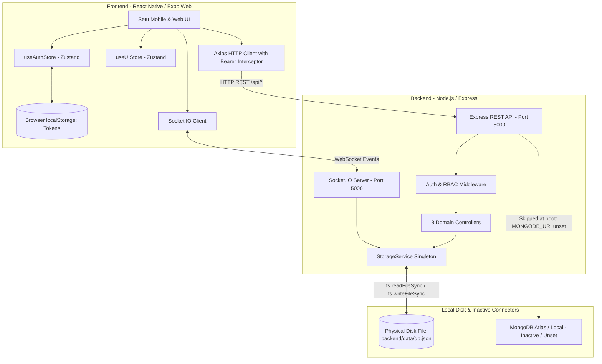

# Setu Application: Data Storage, Architecture & Security Audit Report

**Date:** October 22, 2026  
**Audited Platform:** Setu (formerly IPO Connect)  
**Inspection Mode:** Read-Only Formal Audit  
**Scope:** Full-Stack Architecture, Data Persistence, Authentication, APIs, Security & Storage Footprint

---

## Executive Summary

A comprehensive read-only audit was performed on the **Setu** codebase to identify the precise physical storage locations, persistence characteristics, authentication mechanisms, and data access controls across all application tiers.

### Key Audit Findings:
1. **Primary Database Engine:** The active backend does **not** connect to an external database (MongoDB Atlas, PostgreSQL, Firebase, or Supabase). All application entities are persisted in a **single local JSON flat-file on disk at [`backend/data/db.json`](file:///e:/Projects/IPO/backend/data/db.json)**.
2. **Persistence Behavior:** Data survives page refreshes, backend server process restarts, and multi-device access on localhost because all mutations are written synchronously to `db.json`. However, in ephemeral cloud containers or serverless hosting environments, data will be lost on container restart unless a persistent volume is mounted.
3. **Authentication:** Implemented via a self-hosted custom authentication controller using **bcryptjs** (10-round salt) and **stateless JSON Web Tokens (JWT)** (2-hour access token, 7-day refresh token). Tokens are stored in browser `localStorage`.
4. **Realtime Engine:** Live chat and notifications use **Socket.IO** over WebSockets with room-based isolation (`user:<id>` and `connection:<id>`).
5. **Binary Files & Images:** There is **no object storage or file upload pipeline** (no S3, Cloudinary, or Multer). Profile pictures and documents are stored as external URL strings or masked identifiers in JSON.
6. **Critical Security Findings:** Public directory endpoints (`GET /api/users/holders` and `GET /api/users/profile/:id`) expose users' raw mobile phone numbers and email addresses without requiring authentication. In addition, fallback JWT secrets are hardcoded in source code due to the absence of `.env` files.

---

## Architecture & Data Flow



---

## Section-by-Section Audit Breakdown

### 1. Database Provider
- **Active Database:** Local JSON flat-file storage engine.
- **Physical Path:** [`e:/Projects/IPO/backend/data/db.json`](file:///e:/Projects/IPO/backend/data/db.json) (file size: ~18.6 KB).
- **Driver / Service Layer:** Managed by the `StorageService` class defined in [`backend/src/services/storage.ts:26-296`](file:///e:/Projects/IPO/backend/src/services/storage.ts#L26-L296).
  - Initialization: Reads `db.json` synchronously at server startup via `fs.readFileSync(DB_FILE, 'utf-8')` ([`backend/src/services/storage.ts:48-59`](file:///e:/Projects/IPO/backend/src/services/storage.ts#L48-L59)).
  - Mutation: Executes `fs.writeFileSync(DB_FILE, JSON.stringify(this.data, null, 2), 'utf-8')` on every create or update method call ([`backend/src/services/storage.ts:68-77`](file:///e:/Projects/IPO/backend/src/services/storage.ts#L68-L77)).
- **Mongoose / MongoDB Status:**
  - Full Mongoose schemas and models are defined in [`backend/src/models/mongooseModels.ts`](file:///e:/Projects/IPO/backend/src/models/mongooseModels.ts).
  - [`backend/src/server.ts:102-112`](file:///e:/Projects/IPO/backend/src/server.ts#L102-L112) attempts `mongoose.connect(process.env.MONGODB_URI, { serverSelectionTimeoutMS: 2000 })`, but skips connection because `process.env.MONGODB_URI` is undefined.
  - No controllers import or query Mongoose models; all controllers call `storage.*`.
- **Firebase / Supabase / PostgreSQL / SQLite:** None configured or installed.

---

### 2. Authentication Provider
- **Provider:** Custom, self-hosted Node.js / Express authentication.
- **Signup Controller:** [`backend/src/controllers/authController.ts:17-119`](file:///e:/Projects/IPO/backend/src/controllers/authController.ts#L17-L119).
  - Validates duplicate email and mobile number against `storage.findUserByEmail` and `storage.findUserByMobile`.
- **Login Controller:** [`backend/src/controllers/authController.ts:121-186`](file:///e:/Projects/IPO/backend/src/controllers/authController.ts#L121-L186).
  - Allows authentication via either registered email or mobile number.
- **Password Security:**
  - Hashed with `bcryptjs` using a 10-round salt in `hashPassword()` ([`backend/src/utils/security.ts:6-9`](file:///e:/Projects/IPO/backend/src/utils/security.ts#L6-L9)).
  - Verified via `bcrypt.compare()` in `comparePassword()` ([`backend/src/utils/security.ts:11-16`](file:///e:/Projects/IPO/backend/src/utils/security.ts#L11-L16)).
- **Tokens & Session Management:**
  - Access Token: Signed JWT with 2-hour lifespan; contains `{ userId, email, role }`.
  - Refresh Token: Signed JWT with 7-day lifespan; contains `{ userId }`.
  - Token refresh endpoint: `POST /api/auth/refresh` ([`backend/src/controllers/authController.ts:188-228`](file:///e:/Projects/IPO/backend/src/controllers/authController.ts#L188-L228)).
- **Frontend Token Storage:**
  - Tokens are saved in browser `window.localStorage` under keys `ipo_access_token` and `ipo_refresh_token` ([`mobile/src/services/api.ts:21-30`](file:///e:/Projects/IPO/mobile/src/services/api.ts#L21-L30)).
  - Request interceptor injects `Authorization: Bearer <token>` on all requests ([`mobile/src/services/api.ts:45-54`](file:///e:/Projects/IPO/mobile/src/services/api.ts#L45-L54)).

---

### 3. User Data Storage
- **Storage Location:** `users` array in [`backend/data/db.json`](file:///e:/Projects/IPO/backend/data/db.json).
- **TypeScript Model:** Interface `User` in [`backend/src/models/types.ts:14-38`](file:///e:/Projects/IPO/backend/src/models/types.ts#L14-L38).
- **Stored Data Schema:**
  ```typescript
  interface User {
    id: string;                      // Format: "usr_..."
    fullName: string;                // Legal name
    email: string;                   // Normalized lowercase email
    mobileNumber: string;            // Primary phone with country code
    password: string;                // Bcrypt hash string
    primaryRole: 'investor' | 'demat_holder' | 'admin';
    isEmailVerified: boolean;
    isMobileVerified: boolean;
    isKycVerified: boolean;
    kycDetails?: {
      documentType: string;          // e.g., "PAN / Demat Account Statement"
      documentNumberMasked: string;  // e.g., "XXXX1234"
      submittedAt: string;
      status: 'none' | 'pending' | 'verified' | 'rejected';
      notes?: string;
      verifiedAt?: string;
    };
    avatarUrl?: string;              // External CDN URL string
    city?: string;
    region?: string;
    bio?: string;
    investmentExperience?: string;
    preferredLanguage?: string;
    supportedCategories: string[];
    defaultCommissionRate: number;   // 0 to 50 in 2.5% increments
    commissionBasis: string;
    isAvailable: boolean;
    refreshToken?: string;           // Active refresh token
    createdAt: string;
    updatedAt: string;
  }
  ```

---

### 4. Poke Requests and Connections Storage
- **Poke Requests Storage:** `pokes` array in [`backend/data/db.json`](file:///e:/Projects/IPO/backend/data/db.json).
  - Managed by [`backend/src/controllers/pokeController.ts`](file:///e:/Projects/IPO/backend/src/controllers/pokeController.ts).
  - Interface `PokeRequest` in [`backend/src/models/types.ts:42-60`](file:///e:/Projects/IPO/backend/src/models/types.ts#L42-L60).
  - State Machine: `pending` → `accepted` | `rejected` | `cancelled` | `expired`.
  - Prevents self-pokes, duplicate pending pokes, and pokes when an active connection already exists ([`backend/src/controllers/pokeController.ts:39-70`](file:///e:/Projects/IPO/backend/src/controllers/pokeController.ts#L39-L70)).
- **Active Connections Storage:** `connections` array in [`backend/data/db.json`](file:///e:/Projects/IPO/backend/data/db.json).
  - Managed by [`backend/src/controllers/connectionController.ts`](file:///e:/Projects/IPO/backend/src/controllers/connectionController.ts).
  - Interface `Connection` in [`backend/src/models/types.ts:64-75`](file:///e:/Projects/IPO/backend/src/models/types.ts#L64-L75).
  - Stores: `id`, `userAId` (Demat Holder), `userBId` (Investor), `pokeRequestId`, `agreedCommissionRate`, `agreedCommissionBasis`, `status` (`active` | `disconnected` | `blocked`), `blockedById`, timestamps.
  - Automatically created upon `acceptPoke` execution in [`backend/src/controllers/pokeController.ts:253-275`](file:///e:/Projects/IPO/backend/src/controllers/pokeController.ts#L253-L275).

---

### 5. Commission Storage
Commission records are stored in three locations within [`backend/data/db.json`](file:///e:/Projects/IPO/backend/data/db.json):
1. **Holder Default Rate:** Persisted in `User.defaultCommissionRate` and `User.commissionBasis`.
   - Updated via `PUT /api/commission` ([`backend/src/controllers/commissionController.ts:97-100`](file:///e:/Projects/IPO/backend/src/controllers/commissionController.ts#L97-L100)).
2. **Connection Agreed Rate:** Bound to both `Connection.agreedCommissionRate` and `PokeRequest.agreedCommissionRate`.
   - Locked upon poke acceptance; immutable without mutual renegotiation.
3. **Auditable Rate History:** Persisted in the `commissionHistories` array.
   - Interface `CommissionHistory` in [`backend/src/models/types.ts:91-101`](file:///e:/Projects/IPO/backend/src/models/types.ts#L91-L101).
   - Records: `id`, `holderId`, `previousRate`, `newRate`, `basis`, `targetApplicantId`, `changedById`, `reason`, `timestamp`.
   - Populated on every rate modification in [`backend/src/controllers/commissionController.ts:61-72`](file:///e:/Projects/IPO/backend/src/controllers/commissionController.ts#L61-L72).

---

### 6. Chat Message Storage
- **Message Records:** Stored in the `messages` array in [`backend/data/db.json`](file:///e:/Projects/IPO/backend/data/db.json).
  - Interface `Message` in [`backend/src/models/types.ts:79-89`](file:///e:/Projects/IPO/backend/src/models/types.ts#L79-L89).
  - Stored attributes: `id` (`msg_...`), `connectionId`, `senderId`, `receiverId`, `content`, `type` (`text` | `system` | `commission_proposal`), `metadata`, `readAt`, `createdAt`.
- **Transmission Flow:**
  - HTTP POST: `POST /api/chat/send` validates connection access and status (`active`), writes the message to `db.json`, and triggers real-time broadcast ([`backend/src/controllers/chatController.ts:51-120`](file:///e:/Projects/IPO/backend/src/controllers/chatController.ts#L51-L120)).
  - Real-Time Broadcast: Handled by `socketService.sendToConnection(connectionId, 'message:new', newMessage)` in [`backend/src/services/socketService.ts:93-97`](file:///e:/Projects/IPO/backend/src/services/socketService.ts#L93-L97).
- **Read Receipts:**
  - Automatically marked when a participant loads messages via `GET /api/chat/:connectionId` in [`backend/src/controllers/chatController.ts:34-36`](file:///e:/Projects/IPO/backend/src/controllers/chatController.ts#L34-L36), which updates `readAt` on all unread incoming messages and calls `persist()`.

---

### 7. File and Image Storage
- **Profile Avatars:** Stored only as external URL strings in `User.avatarUrl`. No image files are uploaded or stored locally on the server.
- **Uploaded Documents / Proofs:** Only text strings (masked document numbers) are stored in `kycDetails.documentNumberMasked`.
- **Upload Pipeline:** No upload handlers (`multer`, `busboy`, `formidable`) or cloud object SDKs (`@aws-sdk/client-s3`, `cloudinary`) exist in [`backend/package.json`](file:///e:/Projects/IPO/backend/package.json).

---

### 8. Notification Storage
- **Persistence:** Notifications are **persisted** on the server in the `notifications` array of [`backend/data/db.json`](file:///e:/Projects/IPO/backend/data/db.json).
  - Managed by [`backend/src/controllers/notificationController.ts`](file:///e:/Projects/IPO/backend/src/controllers/notificationController.ts).
  - Handled by `storage.createNotification()`, `storage.markNotificationAsRead()`, `storage.markAllNotificationsAsRead()`.
- **Real-Time Push:** Sent over WebSocket via `socketService.sendToUser(recipientId, 'notification:new', notif)` in [`backend/src/controllers/pokeController.ts:110`](file:///e:/Projects/IPO/backend/src/controllers/pokeController.ts#L110).
- **Client Cache:** The frontend Zustand store (`useUIStore`) caches the unread notification count in memory for badge rendering ([`mobile/src/store/uiStore.ts:38`](file:///e:/Projects/IPO/mobile/src/store/uiStore.ts#L38)).

---

### 9. Environment Configuration
- **Configuration Files:** No `.env` or `.env.example` files exist in the repository root, `backend/`, or `mobile/`.
- **Backend Fallback Variables:** Defined in [`backend/src/config/index.ts:4-21`](file:///e:/Projects/IPO/backend/src/config/index.ts#L4-L21):
  - `PORT`: Defaults to `5000`
  - `NODE_ENV`: Defaults to `'development'`
  - `JWT_SECRET`: Hardcoded default string
  - `JWT_EXPIRES_IN`: Defaults to `'2h'`
  - `REFRESH_TOKEN_SECRET`: Hardcoded default string
  - `REFRESH_TOKEN_EXPIRES_IN`: Defaults to `'7d'`
  - `MONGODB_URI`: Defaults to `'mongodb://localhost:27017/ipo_connect'`
  - `CORS_ORIGIN`: Defaults to `'*'`
  - `appName`: `'Setu'`
- **Frontend Fallback Variables:**
  - `API_BASE_URL`: Hardcoded to `'http://localhost:5000/api'` in [`mobile/src/services/api.ts:4`](file:///e:/Projects/IPO/mobile/src/services/api.ts#L4).
  - Socket URL: Hardcoded to `'http://localhost:5000'` in [`mobile/src/services/socket.ts:20`](file:///e:/Projects/IPO/mobile/src/services/socket.ts#L20).

---

### 10. Persistence Verification

| Scenario | Persistence Verified? | Technical Mechanism |
| :--- | :--- | :--- |
| **Page Refresh** | **Yes** *(Confirmed)* | Tokens stored in `localStorage` are read by `checkAuth()`, which fetches fresh user data via `GET /api/auth/me` ([`mobile/src/store/authStore.ts:93-105`](file:///e:/Projects/IPO/mobile/src/store/authStore.ts#L93-L105)). |
| **App / Server Restart** | **Yes** *(Confirmed)* | Synchronous `fs.writeFileSync` saves all data to disk in `backend/data/db.json`. Re-read via `fs.readFileSync` on server launch ([`backend/src/services/storage.ts:48-77`](file:///e:/Projects/IPO/backend/src/services/storage.ts#L48-L77)). |
| **Multi-Device Login** | **Yes** *(Confirmed)* | Central backend serves all clients from the same `db.json` dataset over HTTP and WebSocket. |
| **Horizontal Scaled Server** | **No** *(Architectural Fact)* | Multiple backend processes will have isolated in-memory instances and overwrite each other's disk writes. |
| **Serverless / Container Redeployment** | **No** *(Architectural Fact)* | Container redeployment on platforms without persistent volumes (e.g., Vercel, Heroku, standard AWS ECS) wipes ephemeral disk storage, resetting `db.json`. |

---

### 11. Production Hosting
- **Current Hosting Status:** **Local Development Only.**
  - Frontend: Running locally on `http://localhost:8081` via Expo Metro bundler.
  - Backend: Running locally on `http://localhost:5000` via `tsx watch src/server.ts`.
- **Cloud Infrastructure:**
  - No remote git repositories attached (`git remote -v` is empty).
  - No cloud hosting configuration exists (no Docker, Kubernetes, Vercel, Render, AWS, or GCP deployment files).
  - No production cloud database exists.

---

### 12. Security Issues

> [!CAUTION]
> **High-Severity Data Privacy Exposure: Unprotected PII on Public Endpoints**
> - In [`backend/src/controllers/userController.ts:82`](file:///e:/Projects/IPO/backend/src/controllers/userController.ts#L82) (`GET /api/users/holders`) and line 133 (`GET /api/users/profile/:id`), the stripping logic removes `password` and `refreshToken`, but **leaves `mobileNumber` and `email` exposed in the returned public JSON**.
> - Any unauthenticated actor can make a `GET` request to `http://localhost:5000/api/users/holders` and retrieve the real email addresses and phone numbers of all registered Demat Account Holders.

> [!WARNING]
> **Hardcoded Fallback JWT Secrets in Source Code**
> - In [`backend/src/config/index.ts:7-9`](file:///e:/Projects/IPO/backend/src/config/index.ts#L7-L9), fallback strings are hardcoded into the source code repository. Because no `.env` file exists, production tokens would be signed using these publicly visible keys.

> [!NOTE]
> **Permissive CORS and Localhost Hardcoding**
> - In [`backend/src/server.ts:38-42`](file:///e:/Projects/IPO/backend/src/server.ts#L38-L42), CORS allows all origins (`origin: true`) with credentials enabled.
> - The mobile client hardcodes `http://localhost:5000`, which prevents connecting to the backend from physical mobile devices on a local area network or in production.

---

## Missing Configuration

1. **Environment Files:** Create `.env` and `.env.example` in `backend/` and `mobile/`.
2. **Database Connection:** Configure a remote `MONGODB_URI` or PostgreSQL connection string.
3. **Secret Key Isolation:** Move JWT secrets out of source code into environment variables.
4. **Cloud Object Store:** Configure AWS S3, Cloudflare R2, or Cloudinary for profile images and KYC document uploads.
5. **Production CORS & URLs:** Set strict domain origins for production environments.

---

## Step-by-Step Instructions to Access Stored Data

### Method 1: Direct File Inspection (Fastest)
Open the active database file directly:
```
e:\Projects\IPO\backend\data\db.json
```
The file is structured as follows:
- `users`: Registered users, hashed passwords, roles, contact details, verification statuses.
- `pokes`: Poke requests, proposed and agreed commission terms.
- `connections`: Active connections between investors and Demat holders.
- `messages`: Chat message records, timestamps, and read receipts.
- `commissionHistories`: Auditable revision log for commission rate changes.
- `notifications`: User notifications with read statuses.
- `auditLogs`: Compliance and security audit trail.

---

### Method 2: Access via Admin REST API
With the backend running on `http://localhost:5000`:

1. **Log in as Compliance Officer:**
   ```bash
   curl -X POST http://localhost:5000/api/auth/login \
     -H "Content-Type: application/json" \
     -d "{\"identifier\":\"compliance.admin@ipoconnect.in\",\"password\":\"AdminSecure2025!\"}"
   ```
2. **Extract the `accessToken`** from the response payload.
3. **Query Admin Endpoints:**
   - **All Registered Users:**
     ```bash
     curl -H "Authorization: Bearer <TOKEN>" http://localhost:5000/api/admin/users
     ```
   - **All Poke Requests:**
     ```bash
     curl -H "Authorization: Bearer <TOKEN>" http://localhost:5000/api/admin/pokes
     ```
   - **All Active Connections:**
     ```bash
     curl -H "Authorization: Bearer <TOKEN>" http://localhost:5000/api/admin/connections
     ```
   - **Complete System Audit Logs:**
     ```bash
     curl -H "Authorization: Bearer <TOKEN>" http://localhost:5000/api/admin/audit-logs
     ```
   - **Platform Statistics:**
     ```bash
     curl -H "Authorization: Bearer <TOKEN>" http://localhost:5000/api/admin/stats
     ```

---

## Production Migration Roadmap

To transition Setu to a production-ready database:

1. **Database Connector:**
   - Supply a MongoDB connection string in `backend/.env`:
     ```env
     MONGODB_URI=mongodb+srv://<user>:<password>@cluster.mongodb.net/setu?retryWrites=true&w=majority
     ```
2. **Controller Query Migration:**
   - Mongoose schemas already exist in [`backend/src/models/mongooseModels.ts`](file:///e:/Projects/IPO/backend/src/models/mongooseModels.ts).
   - Update controller methods in `backend/src/controllers/` to query `UserModel`, `PokeRequestModel`, `ConnectionModel`, and `MessageModel` instead of calling `storage.*`.
3. **Data Import Script:**
   - Run a migration script to read `backend/data/db.json` and execute `insertMany()` into the MongoDB database.
4. **Data Privacy Fix:**
   - In `getHolders` and `getProfileById` in [`backend/src/controllers/userController.ts`](file:///e:/Projects/IPO/backend/src/controllers/userController.ts), sanitize the returned objects by omitting `email`, `mobileNumber`, and `kycDetails`.
